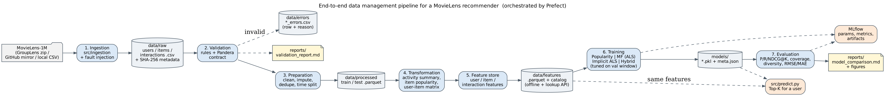
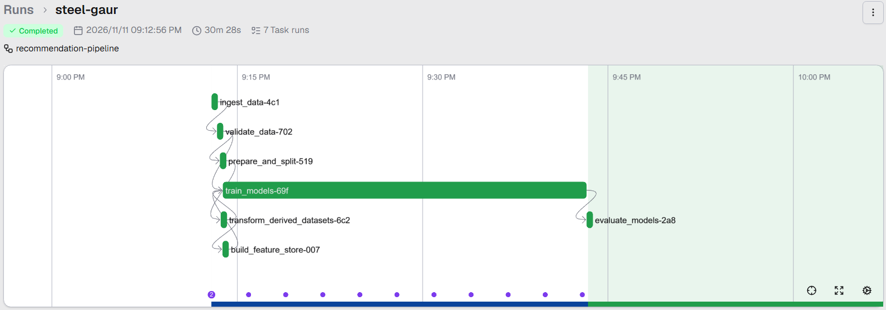
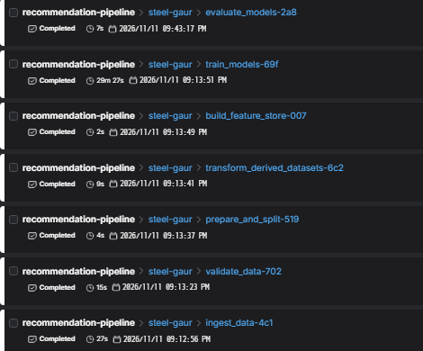
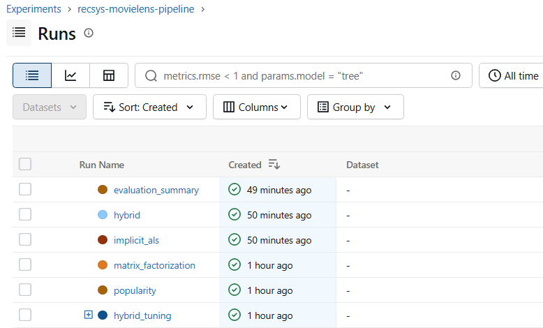
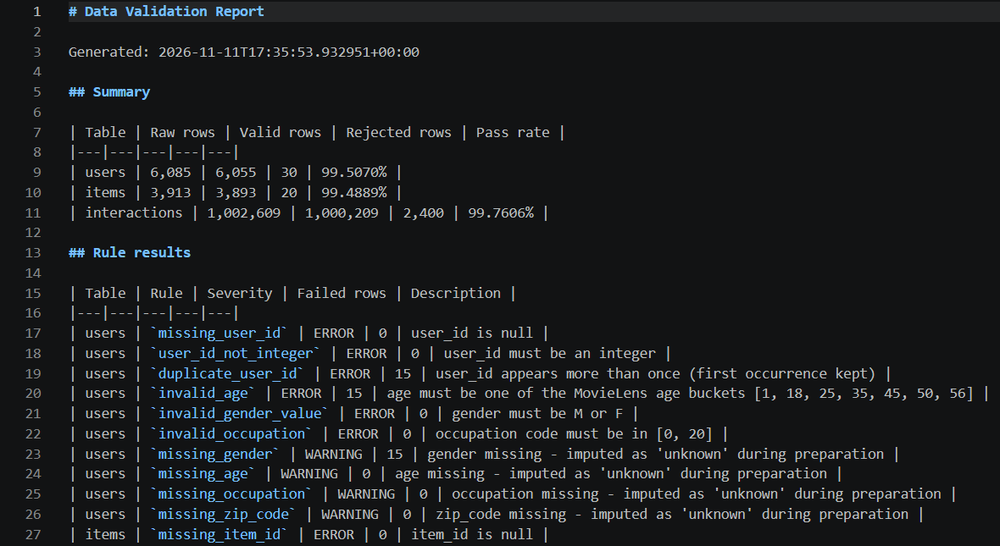
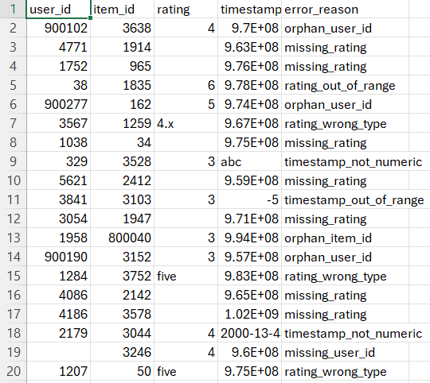
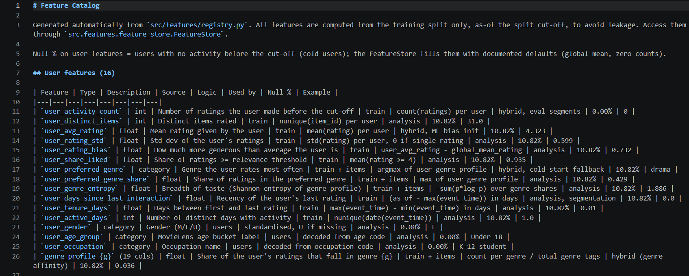

# End-to-End Data Management Pipeline for a Recommendation System

**DM4ML – Assignment 2** · **Author:** Abhinand NTK (2025ag05637) · **Repo:** https://github.com/Abhinand-NTK/Recommendation-pipeline

A modular, reproducible pipeline that turns the public **MovieLens-1M** dataset (6,040 users, 3,883 movies,
1,000,209 ratings) into evaluated top-K movie recommenders. Orchestrated with **Prefect**, tracked with **MLflow**.

```
Data Ingestion → Data Validation → Data Preparation → Data Transformation →
Feature Management → Model Training → Model Evaluation → Orchestration (Prefect)
```



---

## Deliverables checklist

| Assignment deliverable | Location |
|---|---|
| Complete source code organized into modules | [`src/`](src/) (one package per stage) |
| README.md with setup and execution instructions | this file (sections 1–2) |
| requirements.txt | [`requirements.txt`](requirements.txt) |
| Architecture diagram of the pipeline | [`reports/architecture_diagram.png`](reports/architecture_diagram.png) |
| Data validation report or logs | [`reports/validation_report.md`](reports/validation_report.md), [`reports/logs/pipeline.log`](reports/logs/pipeline.log), error dataset in [`data/errors/`](data/errors/) |
| Feature catalog in table format | [`reports/feature_catalog.md`](reports/feature_catalog.md) (also `.csv`) |
| Model evaluation results comparing both models | [`reports/model_comparison.md`](reports/model_comparison.md) (also `.csv` + figures) |
| Orchestration DAG/workflow file | [`dags/recommendation_flow.py`](dags/recommendation_flow.py) (Prefect) and [`dags/run_pipeline.py`](dags/run_pipeline.py) |
| Screenshot of a successful run | [`reports/screenshots/`](reports/screenshots/) (see section 6) |
| Final report (2–3 pages, PDF) | [`reports/Final_Report_Abhinand_NTK_2025ag05637.pdf`](reports/Final_Report_Abhinand_NTK_2025ag05637.pdf) |

## How each requirement is met

| # | Requirement | Implementation |
|---|---|---|
| 1 | **Data ingestion**: user details, item details, user-item interactions | `src/ingestion/ingest.py` downloads MovieLens-1M (official GroupLens zip, GitHub mirror fallback, or local CSVs) → `data/raw/users.csv`, `items.csv`, `interactions.csv` + SHA-256 metadata |
| 2 | **Data validation**: missing values, duplicates, incorrect types, invalid ratings, invalid timestamps, referential integrity; invalid records separated | `src/validation/validate.py`: 29 rules (ERROR/WARNING) + a Pandera schema contract. Rejected rows go to `data/errors/*_errors.csv` with an `error_reason` column; report in `reports/validation_report.md`. A documented, seeded set of corrupt rows is injected (switch off in `configs/config.yaml`) so every check is exercised |
| 3 | **Preparation & transformation**: clean, handle missing values and duplicates, standardize formats, **time-based train/test split**; derived datasets (user activity summary, item popularity, user-item matrix) | `src/preparation/prepare.py` (imputation, dedup, title/genre/zip standardisation, global time split 80/20 at 2000-12-02) and `src/transformation/transform.py` (user activity summary, item popularity with Bayesian average, sparse user×item matrix, genre matrix) |
| 4 | **Feature management**: user, item and interaction features, documented, reusable for training and prediction | `src/features/` – registry (single source of truth), builder, and a `FeatureStore` API used by training, tuning and `src/predict.py`. 34 user, 31 item and 7 interaction features (avg rating, activity count, popularity, item avg rating, preferred genre, days since last interaction…) |
| 5 | **Model training**: popularity baseline + personalized model, tracked in MLflow | `src/training/`: Popularity (baseline), Matrix Factorization (ALS), Implicit ALS (collaborative filtering), Hybrid (CF + content + popularity). Parameters, metrics and artifacts logged to MLflow |
| 6 | **Model evaluation**: Precision@K, Recall@K, NDCG@K, Coverage, Diversity (K = 5/10); RMSE & MAE for rating models; results table | `src/evaluation/` → `reports/model_comparison.md` (K = 10 and K = 5) |
| 7 | **Orchestration**: automated, reproducible, correct task dependencies | `dags/recommendation_flow.py`: Prefect flow, 7 dependent tasks, retries, optional daily schedule. `dags/run_pipeline.py`: dependency-sorted plain-Python runner |

---

## 1. Setup

Requirements: **Python 3.11–3.13** and internet access for the first data download (about 25 MB).

```bash
git clone https://github.com/Abhinand-NTK/Recommendation-pipeline.git recommendation-pipeline
cd recommendation-pipeline

python -m venv .venv
# Windows:      .venv\Scripts\activate
# macOS/Linux:  source .venv/bin/activate

pip install -r requirements.txt
```

## 2. Run the pipeline end-to-end

**Option A – Prefect (recommended, with UI):**
```bash
prefect server start                                          # terminal 1 → http://127.0.0.1:4200
prefect config set PREFECT_API_URL=http://127.0.0.1:4200/api  # terminal 2 (once)
python dags/recommendation_flow.py                            # terminal 2
```
Daily schedule (02:00): `python dags/recommendation_flow.py --serve`

**Option B – plain Python (no services needed):**
```bash
python dags/run_pipeline.py                      # full run
python dags/run_pipeline.py --from-stage train   # re-run training and everything after it
python dags/run_pipeline.py --only evaluate      # one stage
```

A full run takes from about 2 minutes to about 30 minutes depending on the machine. Training is the slowest step.

**View experiments in MLflow:**
```bash
mlflow ui --backend-store-uri sqlite:///mlflow.db     # → http://127.0.0.1:5000 (choose "Model training")
```

**Recommendations for one user** (uses the same feature store as training):
```bash
python -m src.predict --user-id 6040 --model hybrid --k 10
```

**Tests:** `pytest -q`

## 3. Project structure

```
recommendation-pipeline/
├── data/
│   ├── raw/                  # ingested users / items / interactions + ingestion metadata
│   ├── processed/            # validated data, train/test split, derived datasets
│   ├── features/             # offline feature store (parquet + metadata)
│   └── errors/               # rejected records with error_reason
├── src/
│   ├── ingestion/            # ingest.py
│   ├── validation/           # validate.py (rules + Pandera contract + report)
│   ├── preparation/          # prepare.py (cleaning + time-based split)
│   ├── transformation/       # transform.py (activity summary, popularity, user-item matrix)
│   ├── features/             # registry.py, build_features.py, feature_store.py
│   ├── training/             # models.py (4 recommenders), train.py (tuning + MLflow)
│   ├── evaluation/           # metrics.py, evaluate.py
│   ├── common/               # shared utils (config, logging, hashing)
│   ├── reporting/            # architecture diagram + final report generators
│   ├── tests/                # unit tests (pytest)
│   └── predict.py            # serve recommendations for a user
├── dags/                     # recommendation_flow.py (Prefect), run_pipeline.py
├── configs/                  # config.yaml – every parameter and the random seed
├── models/                   # trained models (model.pkl, git-ignored) + meta.json
├── reports/                  # validation report, feature catalog, results, diagram,
│                             # screenshots/, logs/, final report PDF
├── requirements.txt
└── README.md
```

## 4. Results (K = 10, 1,122 warm-start test users)

| Model | P@10 | R@10 | NDCG@10 | Coverage | Diversity | RMSE | MAE |
|---|---|---|---|---|---|---|---|
| Popularity (baseline) | 0.1995 | 0.0493 | 0.2141 | 0.037 | 0.655 | 0.961 | 0.761 |
| Matrix factorization (explicit ALS) | 0.0989 | 0.0273 | 0.1052 | 0.159 | 0.735 | **0.894** | **0.696** |
| Implicit ALS | 0.2129 | 0.0617 | 0.2344 | 0.104 | 0.675 | n/a | n/a |
| **Hybrid** | **0.2189** | **0.0619** | **0.2380** | 0.061 | 0.691 | n/a | n/a |

K = 5 results, the per-segment analysis and charts are in [`reports/model_comparison.md`](reports/model_comparison.md).

## 5. Reproducibility

* One config file (`configs/config.yaml`), a fixed seed (`42`), and pinned package versions.
* Raw-data SHA-256 hashes, the feature-store version and model parameters are tagged on every MLflow run.
* Hybrid weights are tuned on a validation window inside the training period, never on the test set.
* Two consecutive full runs produced identical metrics; `reports/pipeline_run.json` records each task's status and duration.

## 6. Successful run (screenshots)

**Prefect flow run "steel-gaur": all 7 tasks Completed**




**MLflow experiment tracking**


**Validation report and error dataset**



**Feature catalog**

