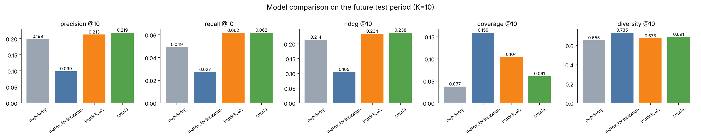
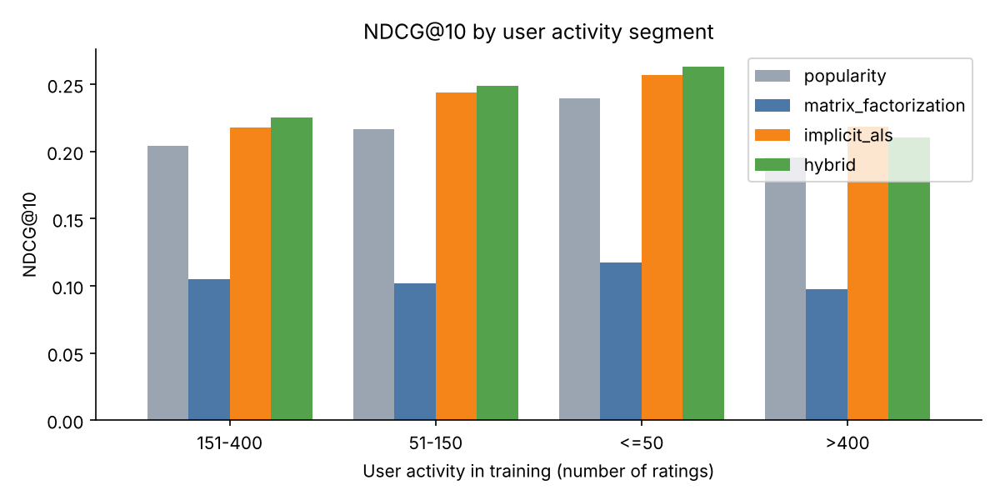

# Model Evaluation Results

Evaluated users: **1,122** warm-start users with at least one relevant (rating >= 4) item in the future test period. Candidates: 3,662 items minus each user's training items.

## Main comparison (K = 10)

| Model | P@10 | R@10 | NDCG@10 | HR@10 | Coverage | Diversity | Novelty | RMSE | MAE |
|---|---|---|---|---|---|---|---|---|---|
| popularity | 0.1995 | 0.0493 | 0.2141 | 0.6328 | 0.0374 | 0.6550 | 8.6238 | 0.9608 | 0.7611 |
| matrix_factorization | 0.0989 | 0.0273 | 0.1052 | 0.4465 | 0.1592 | 0.7346 | 11.3447 | 0.8939 | 0.6958 |
| implicit_als | 0.2129 | 0.0617 | 0.2344 | 0.6720 | 0.1043 | 0.6745 | 8.9735 | n/a | n/a |
| hybrid | 0.2189 | 0.0619 | 0.2380 | 0.6747 | 0.0609 | 0.6913 | 8.7764 | n/a | n/a |

## K = 5

| Model | P@5 | R@5 | NDCG@5 | Coverage | Diversity |
|---|---|---|---|---|---|
| popularity | 0.2102 | 0.0263 | 0.2225 | 0.0246 | 0.5962 |
| matrix_factorization | 0.1080 | 0.0158 | 0.1104 | 0.1171 | 0.7170 |
| implicit_als | 0.2358 | 0.0362 | 0.2503 | 0.0770 | 0.6467 |
| hybrid | 0.2439 | 0.0371 | 0.2547 | 0.0412 | 0.6628 |

## NDCG@10 by user activity segment

| Segment | popularity | matrix_factorization | implicit_als | hybrid |
|---|---|---|---|---|
| 151-400 | 0.2045 | 0.1048 | 0.2182 | 0.2252 |
| 51-150 | 0.2168 | 0.1016 | 0.2442 | 0.2489 |
| <=50 | 0.2396 | 0.1175 | 0.2571 | 0.2629 |
| >400 | 0.1953 | 0.0976 | 0.2185 | 0.2103 |

Metric notes: Coverage = share of catalog recommended to at least one user; Diversity = mean pairwise genre dissimilarity inside a list (0-1); Novelty = mean -log2(item popularity share); RMSE/MAE only for models that predict explicit ratings (implicit ALS and hybrid output preference scores, so they are n/a).

